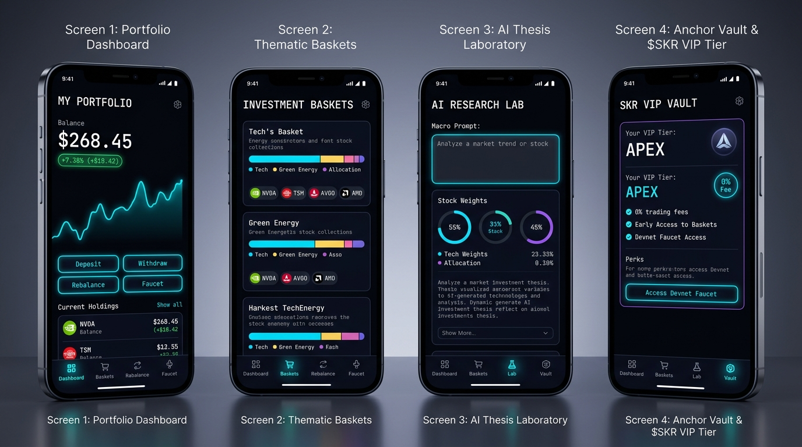

# StockPilot Mobile

<p align="center">
  
</p>

<p align="center">
  <strong>Autonomous 24/7 AI-Driven Wealth Management & Thematic Equity Baskets on Solana.</strong>
</p>

<p align="center">
  <a href="https://solana.com"></a>
  <a href="https://solscan.io/account/CsiP2ZWy1bM6Ghye85r67kiLC2zkBC7FngYCYGAhEPgK?cluster=devnet"></a>
  <a href="https://solanamobile.com"></a>
  <a href="https://reactnative.dev"></a>
  <a href="./LICENSE"></a>
</p>

<p align="center">
  <a href="https://expo.dev/accounts/southenx/projects/stockpilot-mobile/builds/06156e37-11bc-4216-a3db-7770d6cb2dfd"><strong>📲 Download Latest Android APK</strong></a> •
  <a href="https://stockpilotsol.xyz"><strong>🌐 Web App</strong></a> •
  <a href="https://solscan.io/account/CsiP2ZWy1bM6Ghye85r67kiLC2zkBC7FngYCYGAhEPgK?cluster=devnet"><strong>📜 Solscan Explorer</strong></a>
</p>

---

## ⚡ The Thesis: Why StockPilot on Solana?

Retail wealth management is fundamentally broken. Traditional brokerages restrict investing to archaic 9:30 AM–4:00 PM EST market hours, lock user capital into custodial silos, charge high hidden spreads, and offer zero automated portfolio rebalancing.

Tokenized real-world assets (RWAs) are moving rapidly onto Solana, but retail investors lack a non-custodial, user-friendly robo-advisor layer to construct and maintain diversified portfolios.

**StockPilot solves this by bridging conversational macro intelligence with atomic on-chain execution:**
1. **24/7 Liquidity:** Invest in tokenized US equity baskets anytime, day or night, bypassing TradFi banking holidays and market closures.
2. **True Non-Custodial Ownership:** Funds are deposited directly into user-owned Anchor Program Derived Addresses (PDAs). Nobody—not even the protocol—can access or withdraw user capital.
3. **Solana Seeker Hardware Security:** Seamless 1-tap Mobile Wallet Adapter (MWA) authentication natively integrated with Seeker Seed Vault biometric hardware isolation.
4. **Accessible Alpha:** Users translate plain conversational macro ideas into balanced, risk-managed on-chain baskets in seconds.

---

## 🏛️ Core Product Features

### 1. 🛡️ Solana Mobile Stack (SMS) & Seeker Seed Vault
* **Mobile Wallet Adapter (MWA 2.0):** Native bottom-sheet wallet authentication for instant onboarding.
* **Biometric Hardware Custody:** Signs transactions inside the Seeker Seed Vault or Android wallets (Phantom, Solflare) with zero private key exposure.
* **Persistent Single-Task Lifecycle:** Activity management guarantees zero session drops during external wallet signing.

### 2. 📊 Thematic Equity Strategies (Baskets)
Curated baskets designed for macro sector exposure with automated target weighting:

| Strategy | Ticker Allocation | APY Target | Rebalance Engine | Status |
| :--- | :--- | :---: | :---: | :---: |
| **AI Semiconductor Titans** | NVDA (35%), TSM (25%), AMD (20%), MSFT (20%) | **+28.4%** | Autonomous Drift | Active |
| **Clean Energy & Nuclear** | CEG (35%), VST (25%), NEE (20%), CCJ (20%) | **+19.2%** | Autonomous Drift | Active |
| **Magnificent Tech Titans** | AAPL (30%), MSFT (25%), GOOGL (25%), AMZN (20%) | **+22.1%** | Autonomous Drift | Active |
| **Seeker Quant Alpha ($SKR)** | NVDA (30%), TSLA (25%), COIN (25%), $SKR (20%) | **+34.6%** | High-Frequency | 💎 VIP |

### 3. 🤖 AI Strategy Architect
* Users describe any investment thesis in plain English (e.g. *"Next-generation humanoid robotics and energy storage"*).
* The Gemini-powered AI engine synthesizes the optimal risk-weighted equity basket in real-time.
* 1-Tap initialization deploys the strategy directly to an on-chain Anchor vault.

### 4. ⚡ Autonomous Drift & Rebalancing Engine
* Monitors real-time asset weight divergence against target parameters.
* When portfolio drift exceeds the target threshold (e.g., ≥3.0%), one-tap rebalancing executes atomic swaps to restore target balance.
* Sub-second settlement and sub-cent network gas on Solana Devnet.

### 5. 💎 $SKR Utility & Seeker Genesis VIP Tiers
* **Protocol Fee Monetization:** 15 basis points (0.15%) protocol fee collected on-chain directly to the protocol treasury wallet.
* **Fee Discount Tiers:**
  * **Cadet (0 $SKR):** 15 bps protocol fee
  * **Radiant Pilot (500 $SKR):** 50% discount (7.5 bps)
  * **Genesis Seeker VIP (2,500 $SKR):** **0% Protocol Fees (Free Lifetime Rebalancing)**
* **Exclusive Strategies:** Access to high-alpha Seeker Quant portfolios.

---

## 🏗️ System Architecture

```
┌────────────────────────────────────────────────────────────────────────┐
│                          STOCKPILOT CLIENT LAYER                       │
│       React Native 0.86  •  Expo SDK 57  •  Dark Cyberpunk UI/UX       │
└───────────────────────────────────┬────────────────────────────────────┘
                                    │
                                    ▼
┌────────────────────────────────────────────────────────────────────────┐
│                        SOLANA MOBILE STACK (SMS)                       │
│    Mobile Wallet Adapter (MWA)  ──►  Seeker Seed Vault / Phantom / Solflare
└───────────────────────────────────┬────────────────────────────────────┘
                                    │
                                    ▼
┌────────────────────────────────────────────────────────────────────────┐
│                     ON-CHAIN ANCHOR PROGRAM LAYER                      │
│            Program ID: CsiP2ZWy1bM6Ghye85r67kiLC2zkBC7FngYCYGAhEPgK     │
├───────────────────────────────────┬────────────────────────────────────┤
│  initialize_vault                 │ Creates non-custodial PDA vault    │
│  deposit                          │ Transfers capital with 15 bps fee  │
│  withdraw_sol                     │ Non-custodial user capital egress  │
│  rebalance                        │ Executes atomic weight rebalance   │
└───────────────────────────────────┴────────────────────────────────────┘
```

---

## 📜 Verified On-Chain Deployments

| Component | Identifier / Address | Explorer |
| :--- | :--- | :--- |
| **Anchor Program ID** | `CsiP2ZWy1bM6Ghye85r67kiLC2zkBC7FngYCYGAhEPgK` | [View on Solscan](https://solscan.io/account/CsiP2ZWy1bM6Ghye85r67kiLC2zkBC7FngYCYGAhEPgK?cluster=devnet) |
| **Protocol Treasury** | `2KtVKiQCMbHrsdAPyjQVVnccpgvt3Y8ggrjgxXCSPyEo` | [View on Solscan](https://solscan.io/account/2KtVKiQCMbHrsdAPyjQVVnccpgvt3Y8ggrjgxXCSPyEo?cluster=devnet) |
| **Network Cluster** | Solana Devnet (`https://api.devnet.solana.com`) | Devnet Cluster |
| **Devnet USDC Mint** | `4zMMC9srt5Ri5X14GAgXhaHii3GnPAEERYPJgZJDncDU` | Circle Devnet Mint |

---

## 🛠️ Local Development & Build Guide

### Prerequisites
* Node.js 20+ & pnpm
* Android Studio (with Android SDK 34+)
* EAS CLI (`npm install -g eas-cli`)

### Setup Instructions

```bash
# 1. Clone the repository
git clone https://github.com/southenempire/stockpilot-mobile.git
cd stockpilot-mobile

# 2. Install dependencies
pnpm install

# 3. Typecheck codebase
npx tsc --noEmit

# 4. Start Expo development server
npx expo start

# 5. Build native Android APK via EAS
npx eas-cli build --platform android --profile preview
```

---

## 👤 Author

Built by **Southen** ([@southenempire](https://github.com/southenempire))

* **Web Application:** [stockpilotsol.xyz](https://stockpilotsol.xyz)
* **GitHub Repository:** [github.com/southenempire/stockpilot-mobile](https://github.com/southenempire/stockpilot-mobile)

---

## 📄 License

This project is licensed under the [MIT License](./LICENSE).
